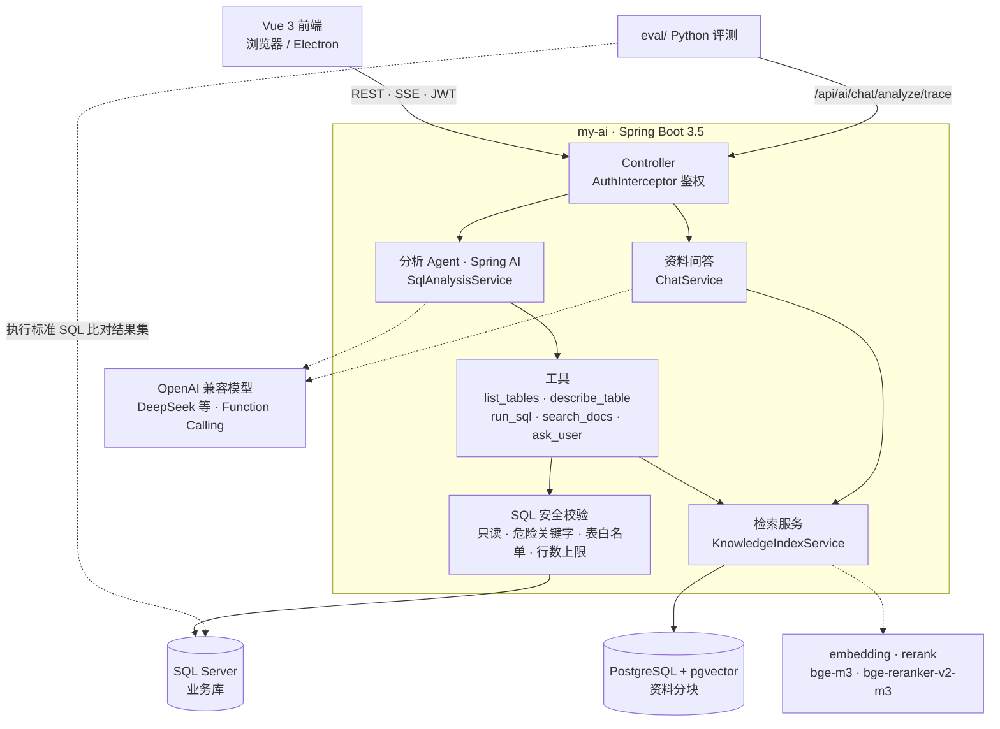
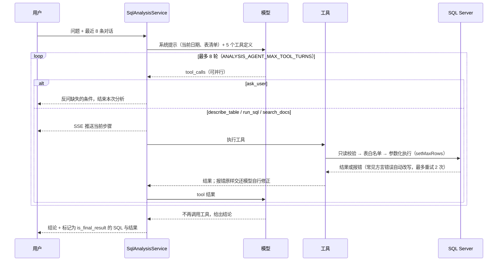
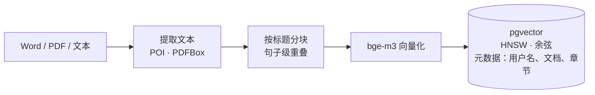
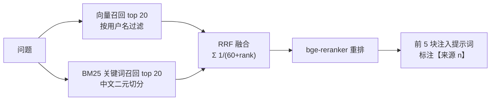

# WMS 智能仓储辅助决策系统

一个面向毕业设计演示的前后端分离 WMS 智能助手项目，围绕库存预警、自然语言数据分析、资料增强问答和文档处理构建仓储辅助决策闭环。

- `ai-frontend`: Vue 3 + Vite + Electron 前端工作区
- `my-ai`: Spring Boot 3.5 / Spring AI 1.1 / Java 17 后端，提供认证、聊天、库存工具、资料管理、文档处理和 SQL 分析接口
- `eval`: Python 离线评测（Text-to-SQL 测试集与留出集、RAG 检索与问答评测），见 [eval/README.md](eval/README.md)

## 架构



### 分析 Agent：工具调用循环

模型只拿到当前日期和可查询表清单，字段口径、取值范围、业务规则都通过工具按需获取。
工具执行由后端自己控制（Spring AI `internalToolExecutionEnabled(false)`），因此步数上限、SSE 进度推送和 SQL 安全校验都在同一个循环里。



- **结论可溯源**：`run_sql` 带 `is_final_result` 参数，模型必须标出回答依据的那条查询，前端展示和评测判分都以它为准。
- **轮数用尽**：追加一条提示并以 `tool_choice=none` 再调用一次，要求模型基于已有结果作答。
- **对照模式**：`ANALYSIS_AGENT_MODE=json` 切回旧版"模型输出 JSON 文本、后端正则解析"的实现，用于评测对比。

### 资料问答：RAG 检索链路

入库（上传后异步执行）：



检索：



- **账号隔离**：向量召回和关键词召回都按当前用户名过滤，删除资料时同步删除分块；启动时对账，内容变化的文档自动重建索引。
- **降级**：未配置 embedding Key 或向量库连接失败时，回退为原来的整篇拼接，其余功能不受影响。
- **同一套检索两处使用**：资料问答直接注入上下文；分析 Agent 通过 `search_docs` 工具调用，可以先查制度里的阈值再查库存。
- **已知限制**：BM25 在内存中对当前用户的全部分块打分，适合单用户几百块的规模；资料量再大需要换成数据库全文索引。

## 快速启动

### 1) 启动后端

在 `my-ai` 目录执行。默认连接本地 SQL Server 数据库 `myai`，本机演示需要提供 `DB_PASSWORD`。

```powershell
$env:JWT_SECRET='dev-jwt-secret-should-be-at-least-32-bytes'
$env:DB_PASSWORD='<初始化时设置的 myai_user 密码>'
$env:LLM_BASE_URL='https://api.deepseek.com'
$env:LLM_MODEL='<your-model>'
$env:LLM_API_KEY='<your-api-key>'
.\mvnw.cmd spring-boot:run
```

默认地址：`http://localhost:8081`

也可以在前端 `系统配置` 页面保存 OpenAI-compatible 模型配置；保存后分析助手会随请求发送该配置。

不要把真实 API Key 写入代码、README、`.env` 或提交记录。

### 2) 启动前端
在 `ai-frontend` 目录执行：

```powershell
npm install
npm run dev -- --host 127.0.0.1 --port 5173 --strictPort
```

访问：`http://127.0.0.1:5173`

前端必须使用 `5173`，后端默认 CORS 只允许 `http://localhost:5173` 和 `http://127.0.0.1:5173`。

### macOS / Linux 本地开发

```bash
cp my-ai/.env.example my-ai/.env            # 填写数据库口令、JWT_SECRET、模型 Key 等
docker compose -f docker-compose.dev.yml --env-file my-ai/.env up -d   # SQL Server
python3 -m venv eval/.venv && eval/.venv/bin/pip install -r eval/requirements.txt
eval/.venv/bin/python -I eval/setup_db.py   # 建库并写入评测用合成数据
my-ai/start-dev.sh
```

## 分析 Agent 与评测

分析助手默认使用原生 Function Calling（Spring AI）：模型通过 `describe_table` 按需读取字段口径和枚举取值，
用 `run_sql` 执行只读查询（出错时把错误交还模型修正），并标记回答所依据的查询，使结论可以回溯到具体 SQL。
旧版 JSON 文本动作模式保留为 `ANALYSIS_AGENT_MODE=json`，用于对照。

在 100 条分类测试集上，执行准确率从原实现的 70.3% 提升到 95.5%，30 条留出集上从 66.7% 提升到 100%。
测试集、评分方式和复现步骤见 [eval/README.md](eval/README.md)。

## 资料问答（RAG）

上传的资料按标题切块，用 bge-m3 向量化写入 pgvector，检索时向量与 BM25 关键词两路召回、RRF 融合，
再用 bge-reranker 重排取前 5 块，回答标注来源。分析 Agent 也可以通过 `search_docs` 工具先查制度规则再查数据。
向量库或 embedding 服务不可用时自动回退为整篇拼接。

资料扩充到 30 篇（43k 字）时，原来的整篇拼接回答准确率降到 47.5%，检索方式保持 100%，输入 token 约为原来的 1/24。
需要额外配置 `EMBEDDING_API_KEY`（OpenAI 兼容的 embedding / rerank 服务，默认硅基流动）和 pgvector（`docker-compose.dev.yml` 已包含）。

## 关键环境变量

后端（`my-ai`）：
- `JWT_SECRET`（必填）：JWT 签名密钥，至少 32 字节
- `LLM_API_KEY`：OpenAI 兼容模型 API Key
- `LLM_BASE_URL`：默认 `https://api.deepseek.com`
- `LLM_MODEL`：模型名称，例如 `deepseek-chat`、`qwen-plus`、`gpt-4o-mini`
- `LLM_REQUEST_TIMEOUT_SECONDS`：请求超时秒数，默认 `20`
- `DB_URL/DB_USERNAME/DB_PASSWORD`：数据库配置（默认本地 SQL Server：`jdbc:jtds:sqlserver://localhost:1433/myai`）

本地 SQL Server 需先启动默认实例，并在首次使用前执行后端目录中的初始化脚本：

```powershell
cd my-ai
sqlcmd -S localhost -E -v MYAI_DB_PASSWORD="<自定义密码>" -i .\init-myai.sql
sqlcmd -S localhost -E -i .\grant-myai.sql
```

如果本地已经创建了 `myai_user`，可用下面命令检查连接：

```powershell
sqlcmd -S localhost -U myai_user -P "<自定义密码>" -d myai -Q "SELECT DB_NAME();"
```

前端（`ai-frontend`）：
- `VITE_API_BASE_URL`：后端地址，默认 `http://localhost:8081`

## 已实现能力

- 管理员登录/改密（JWT）与用户管理
- 登录态路由保护
- 智能对话文本流式返回（SSE over fetch + Authorization 头）
- 多会话本地存储与后端会话同步
- 资料管理：上传、查看、删除智能对话知识资料
- 知识资料增强问答：智能对话优先参考当前账号上传的资料
- 分析助手：基于 SQL 工具调用的多步库存/销售分析
- 库存洞察页（低库存 + 按商品查询）
- 文档处理：上传文档、提取文本、处理结果预览与下载
- 系统配置：真实数据库连接和模型调用配置
- 账号设置：主题切换、修改密码、退出登录

说明：公开注册已关闭，普通账号由管理员在“用户管理”中创建。

说明：当前文本模型路径不承诺图片理解能力，图片入口仅作为对话附件展示/预留能力；毕业设计演示建议以文本问答、资料问答、库存洞察和分析助手为主线。

## 前端功能区

- `智能对话`：文本对话、资料增强问答、多会话管理
- `分析助手`：自然语言分析库存/销售数据，后端执行只读 SQL 并返回分析结论
- `库存洞察`：查看低库存预警，按商品查询库存/SKU/供应商信息
- `资料管理`：上传智能对话资料，管理当前账号的知识文档
- `文档处理`：上传文档并按要求处理，支持结果预览和下载
- `系统配置`：维护分析助手数据库连接和模型请求级配置
- `账号设置`：查看当前账号、修改密码、切换主题、退出登录

## 演示建议

1. 使用管理员账号登录系统。
2. 在 `资料管理` 上传一份业务资料，展示知识库维护。
3. 在 `智能对话` 提问资料相关问题，验证资料增强问答。
4. 在 `库存洞察` 查看低库存预警并查询商品。
5. 在 `分析助手` 输入库存/销售分析问题，展示真实数据库查询、SQL 明细与分析结论。
6. 在 `系统配置` 展示真实数据库连接和模型配置入口。
7. 在 `文档处理` 或 `用户管理` 展示扩展能力与后台管理能力。

## 测试与构建

后端测试：
```powershell
cd my-ai
.\mvnw.cmd test
```

前端测试：
```powershell
cd ai-frontend
npm test
```

前端构建：
```powershell
cd ai-frontend
npm run build
```

真实模型接口冒烟测试前，请确认当前 PowerShell 会话中已设置 `LLM_API_KEY`。
